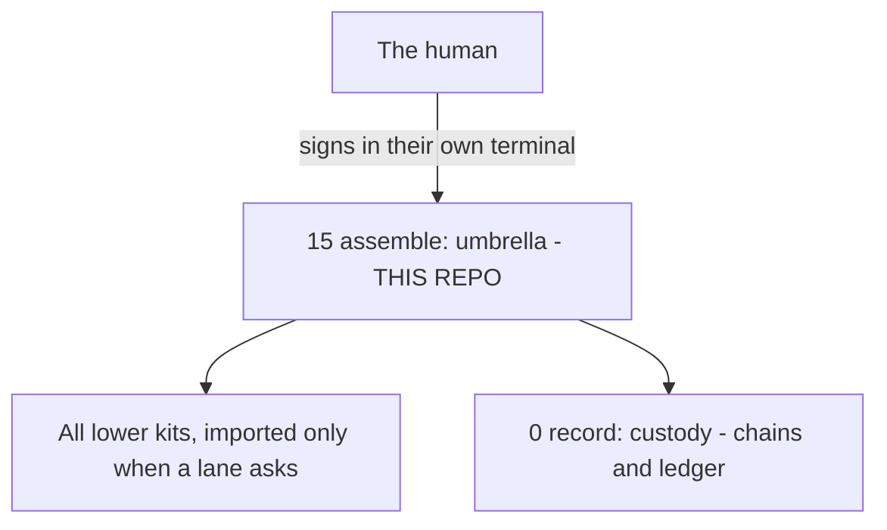
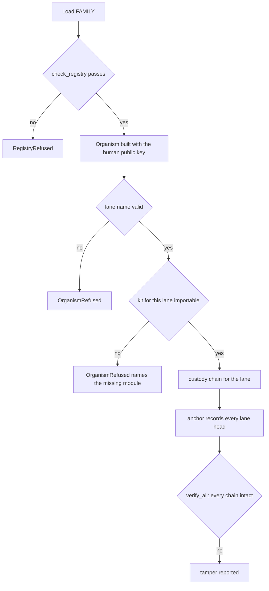
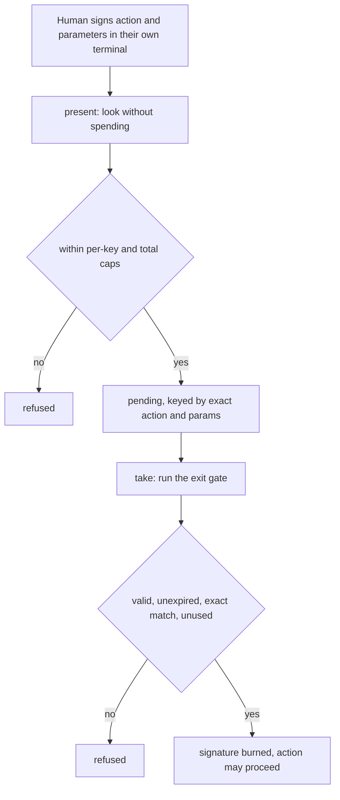
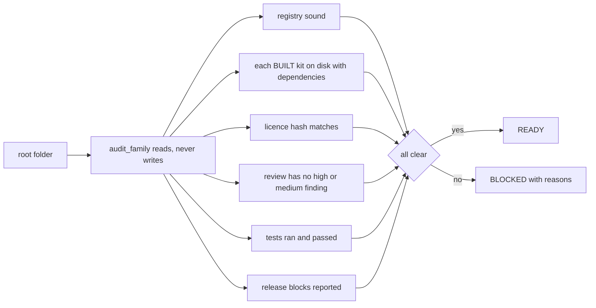

# vega-umbrella-sdk — Architecture

**Contents:** [Layer map](#where-it-sits) · [Components](#components) · [Assembly workflow](#assembly-workflow-and-where-it-fails-closed) · [Approval workflow](#approval-workflow-and-where-it-fails-closed) · [Audit workflow](#audit-workflow) · [Custom constraints](#custom-constraints)

## Where it sits

Layer 15, assemble, the top of the stack. The whole map is in [ORGANISM.md](ORGANISM.md).

## Components

| Module | Concern | Uses |
|---|---|---|
| `registry` | Who owns what, layers, order | none |
| `organism` | One key, one ledger, one gate, lanes, anchor | custody; other kits lazily |
| `audit` | Read-only pre-deploy check | registry, custody `safepaths` |
| `feedback` | Feedback draft | registry names |
| `__main__` | Command line | registry, audit |

## Assembly workflow and where it fails closed

| Stop point | Mechanism | Where |
|---|---|---|
| Unsound registry | raise | `registry.check_registry` |
| Bad lane name | raise | `organism.Organism.lane` |
| Missing kit | raise on request | `organism._need` |
| Broken chain | reported by `verify_all` | `organism.Organism.verify_all` |

## Approval workflow and where it fails closed

| Stop point | Mechanism | Where |
|---|---|---|
| Unsigned or foreign-signed commitment | keyed ledger refuses | `Organism` |
| Reuse or wrong action | exit gate refuses | `Approvals.take` |
| Flooding pending approvals | caps | `PRESENT_CAP`, `PER_KEY_CAP` |

## Audit workflow

## Custom constraints

Extension points in the published code: new registry entries (each must claim an unowned concern and depend only on lower layers) and the lanes registered with the Organism. User-defined constraints may be STRICTER than the legal minimum for the applicable jurisdiction, never looser. Jurisdictional legal minimums are defined by the jurisdiction registry (vega-jurisdiction-sdk); a custom constraint that would drop below a registered minimum is rejected at the gate.
