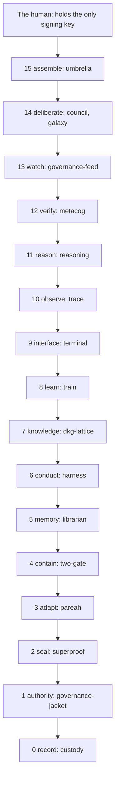
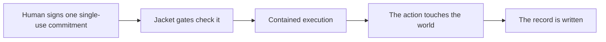
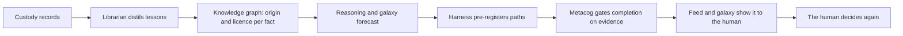

# The Vega family as one organism

Seventeen kits, sixteen layers, one rule: every SDK owns exactly one concern and uses the owner of every other concern instead of growing its own copy. Dependencies point down the layers, never up or sideways, and the registry in this repo refuses a cycle.

**Contents:** [Layers](#the-layers) · [The two flows](#the-two-flows-that-never-mix) · [Dependencies](#dependency-table) · [Use one or all](#use-one-kit-or-the-whole-family)

## The layers

| Layer | Concern | Kit |
|---|---|---|
| 15 assemble | The family as one organism: one key, one ledger, registry, audit | vega-umbrella-sdk |
| 14 deliberate | Multi-brain deliberation and the design-first builder | vega-council-sdk |
| 14 deliberate | The galaxy view of the knowledge lattice | vega-galaxy-sdk |
| 13 watch | The live view of every chain and the tamper alarms | vega-governance-feed-sdk |
| 12 verify | Evidence rungs and the completion gate | vega-metacog-sdk |
| 11 reason | Reasoning fidelity, forecasting and routing | vega-reasoning-sdk |
| 10 observe | Telemetry of reasoning: traces, entropy, harmonic echo | vega-trace-sdk |
| 9 interface | Gated command execution for people and agents | vega-terminal-sdk |
| 8 learn | Governed model training and freeze cards | vega-train-sdk |
| 7 knowledge | The knowledge graph and repo-library processing | vega-dkg-lattice-sdk |
| 6 conduct | Deterministic workflow conduct and the library use gate | vega-harness-sdk |
| 5 memory | Lessons and memory of past incidents | vega-librarian-sdk |
| 4 contain | Containment between two gates and the hard stop | vega-two-gate-sdk |
| 3 adapt | Adapters, cards and quarantine of inbound code | vega-pareah-sdk |
| 2 seal | Layered sealing and proof tiers | vega-superproof-sdk |
| 1 authority | Human-only actions, single-use signed commitments, gates | vega-governance-jacket-sdk |
| 0 record | Capsules, DAG, hash-chained ledger, safe paths | vega-custody-sdk |

## The two flows that never mix

**Authority flows down from the human, never from the model.**

**Knowledge flows up from the record.**

The model reasons freely inside this loop. It never holds the signing key, it can never mint or widen authority, and every step lands in the append-only chain that anyone can verify without trusting the model, the vendor or the project.

## Dependency table

| Kit | Layer | Requires |
|---|---|---|
| custody | 0 | none |
| governance-jacket | 1 | custody |
| superproof | 2 | custody |
| pareah | 3 | custody, jacket |
| two-gate | 4 | custody, jacket |
| librarian | 5 | custody |
| harness | 6 | custody, jacket, librarian |
| dkg-lattice | 7 | custody |
| train | 8 | custody, jacket, harness, pareah, dkg-lattice, superproof |
| terminal | 9 | custody, jacket |
| trace | 10 | custody |
| reasoning | 11 | custody |
| metacog | 12 | custody |
| governance-feed | 13 | custody |
| council | 14 | custody, harness |
| galaxy | 14 | custody, reasoning |
| umbrella | 15 | custody, jacket, terminal, trace, reasoning, metacog, governance-feed, council |

Source of truth: `registry.FAMILY` in this repo. If this table and the registry disagree, the registry wins. The registry also lists further kits that are not part of this release.

## Use one kit or the whole family

Each kit installs alone with `pip install -e .` and declares only the family kits it really needs. To run them together, the umbrella's Organism builds one keyed ledger, one exit gate and one approval check and hands them to each lane, so the weakest chain cannot define the whole. A deployment that skips the Organism and builds its own ledger loses that guarantee.
