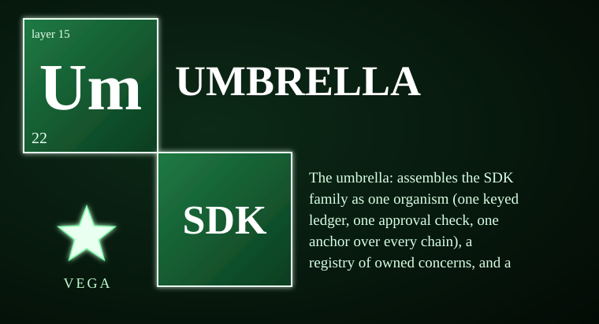
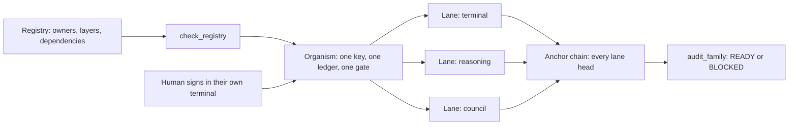

# vega-umbrella-sdk

**One organism from separate kits.** The Vega family is a set of small SDKs, each owning exactly one concern: records, human authority, sealing, containment, memory, knowledge, reasoning, deliberation and more. This kit is the umbrella. It holds the registry that says who owns what, assembles the family around one human key, one keyed ledger and one approval check, and runs a read-only audit before anything is deployed. Start here for the map of the whole family.

> **Licensing.** Source-available, not open source. Free for personal use; free for registered small businesses (under US$1M revenue and valuation); everyone else needs a commercial license (see LICENSE; for a commercial license write to jasonblasiak.ai.mail@gmail.com). Patent pending. Draft licence text, not yet reviewed by an attorney.

## The AI paradox, and one answer to it

**The paradox.** The more an AI can do for you, the more it can do to you. Autonomy is what makes it useful. Unchecked autonomy is what makes it unsafe. And asking the model to police itself fails for a simple reason: the thing being checked is also doing the checking. Most of today's answers are policies, promises and prompts, and none of them is something you can verify.

**The answer in one sentence.** Authority to act stays with a human and is spent one action at a time: nothing consequential runs unless a person has signed a single-use, time-limited commitment that names that exact action, and everything else is written to a tamper-evident record that anyone can check without trusting the model, the vendor or this project.

This is governance above the model, not inside it. The model can reason, plan and draft freely. It cannot act on the world, and it cannot give itself permission to.

| The concern people raise | What addresses it here |
|---|---|
| Who authorised that action? | Human-signed single-use commitments; a gate that refuses without one (governance-jacket, two-gate) |
| Can the AI authorise itself or widen its own powers? | No agent can mint or extend a commitment; authority is non-transitive (governance-jacket, pareah) |
| Can I prove afterwards what happened, and that nothing was altered? | An append-only, hash-chained record of custody, plus sealed evidence (custody, superproof) |
| What if an unknown or hostile agent connects? | An adapter that admits only what the owner announced and holds everything else in a dead end (pareah) |
| Where did the knowledge and the training data come from? | A licence-aware knowledge graph and governed training that records exactly what a model learned from (dkg-lattice, train, librarian) |
| Is the reasoning sound, and did it read what it claims it read? | Pre-execution reasoning checks, meta-audit and traces (reasoning, metacog, trace) |
| Can I see and steer it? | A visible galaxy of what the system knows, a governed terminal and a live governance feed (galaxy, terminal, governance-feed) |

**What this is not.** It is not a complete solution to AI risk, and it does not make a model aligned, truthful or kind. It does not replace a lawyer, an auditor or an independent security review: none of the cryptography or protocol code here has had an independent expert review. These are software reference models; the hardware designs are not built. It narrows one specific and important gap: the distance between "the AI decided" and "a human authorised".

## At a glance

| | |
|---|---|
| Package | `vega_umbrella` (src layout) |
| Version | 0.1.0 |
| Layer | 15 of 16, assemble |
| Declared dependencies | custody, governance-jacket, terminal, trace, reasoning, metacog, governance-feed, council |
| Python | 3.10 or newer, pure Python |
| Command line | `python -m vega_umbrella status`, `order`, `audit ROOT LICENSE_SHA256` |
| Tests | 61 tests in 5 files, all passing (STATUS.md) |
| Status | Reference implementation, work in progress |

**Contents:** [Capabilities](#capabilities) · [Flow](#end-to-end-flow) · [Controls](#controls) · [Cannot do](#what-it-cannot-do) · [Platforms](#platform-support) · [Install](#install-standalone-and-unified) · [Diagnostics](#diagnostic-control) · [Fail closed](#fail-closed-and-custom-constraints) · [Family map](#the-family-map) · [Tests](#tests)

## Capabilities

| Capability | Where it lives | How you can check it |
|---|---|---|
| Registry: every SDK, the one concern it owns, its layer and status | `registry.FAMILY` | `tests/redteam_1_registry_and_audit.py` |
| Refuses two owners of one concern, upward or sideways dependencies, cycles | `registry.check_registry` | `tests/redteam_1_registry_and_audit.py` |
| Dependency-first build order | `registry.build_order` | `tests/test_umbrella.py` |
| One keyed ledger that refuses commitments the human key did not sign | `organism.Organism` | `tests/redteam_2_approvals.py` |
| One approval check, single-use, exact-action | `organism.Approvals` | `tests/redteam_2_approvals.py` |
| One chain per lane plus an anchor chain covering every lane head | `organism.Organism` | `tests/test_umbrella.py` |
| Read-only pre-deploy audit with READY or BLOCKED and reasons | `audit.audit_family` | `tests/redteam_1_registry_and_audit.py` |
| Feedback draft: a mailto link to the owner, never sent by the software, refuses key-shaped text | `feedback` | `tests/test_feedback.py` |

## End-to-end flow

1. **Register.** The registry names each SDK, its layer, the one concern it owns and what it requires.
2. **Check.** `check_registry` refuses a bad entry before anything else runs.
3. **Assemble.** The Organism builds the shared ledger, exit gate and approval check once, and hands them to each SDK lane. An SDK is imported only when its lane is asked for.
4. **Approve.** The human signs in their own terminal. The Organism presents the signature; it never signs.
5. **Anchor.** One chain records every lane's head hash, so one root covers the whole organism.
6. **Audit.** `audit_family` reads the SDK folders and reports READY or BLOCKED. It never writes and never publishes.

## Controls

| Control | What it does |
|---|---|
| `python -m vega_umbrella status` | Prints each SDK's layer, owned concern and status as JSON. Fails if the registry is unsound. |
| `python -m vega_umbrella order` | Prints the dependency-first build order. |
| `python -m vega_umbrella audit ROOT LICENSE_SHA256` | Audits the SDK folders under ROOT against the canonical licence hash. Exit code 0 only for READY. |
| `registry.check_registry(family)` | Validate a registry. Raises `RegistryRefused`. |
| `organism.Organism` | The assembled family: lanes, anchor, approvals. Raises `OrganismRefused`. |
| `feedback.FeedbackConfig`, `build_message` | Build a feedback draft addressed to the configured owner address. |

## What it cannot do

- **It never signs anything.** The human signs; the umbrella only presents the signature.
- **A deployment that bypasses the Organism loses the guarantee.** Building your own ledger drops the single-key rule.
- **READY is not permission to publish.** It means nothing the audit looks at is in the way.
- **Feedback is a draft, not a send.** No mail password is carried in the software, and the owner address must be configured first.
- **Not production-hardened and not independently security-reviewed.** Passing tests and a clean scan are not proof of safety.
- **Crypto is not expert-reviewed.**
- **The registry is a description, not a proof.** It says what each kit claims to own; the audit checks folders and metadata, not behavior.

## Platform support

| Platform | Support |
|---|---|
| Windows, macOS, Linux | Runs anywhere CPython 3.10+ runs for the registry, audit and feedback. The Organism relies on the custody kit's chain storage; see that kit for file-system notes. |
| Android, iOS | No native mobile build is published. The SDK is pure Python and can run inside a Python runtime on Android (Termux) or Apple platforms (BeeWare/Kivy) where that runtime supports its dependencies. |

## Install standalone and unified

**Standalone.** `pip install -e .` installs the umbrella and declares eight family dependencies. The registry, audit and feedback modules need only the custody kit; the Organism imports other SDKs only when a lane asks for them.

**Unified.** This is the unifying kit. Its registry entry is layer 15, `assemble`, owning the assembly of the family as one organism. The family map is in [ORGANISM.md](ORGANISM.md).

## Diagnostic control

The command line above is the diagnostic surface. `status` and `order` are read-only. `audit` returns a JSON report with the per-SDK reasons and exits non-zero for BLOCKED. A diagnostic UI design for this layer exists in the Vega OS interface program; it is not shipped with this package.

## Fail closed and custom constraints

Bad registry entries, unsigned commitments, reused approvals and key-shaped feedback are refused. See [ARCHITECTURE.md](ARCHITECTURE.md) for every stop point.

User-defined constraints may be STRICTER than the legal minimum for the applicable jurisdiction, never looser. Jurisdictional legal minimums are defined by the jurisdiction registry (vega-jurisdiction-sdk); a custom constraint that would drop below a registered minimum is rejected at the gate. The extension points in this version are new registry entries (which must claim an unowned concern and point only downward) and the lanes you register with the Organism.

## The family map

Seventeen kits ship in this release. The full layer diagram, the two flows that never mix and the dependency table are in [ORGANISM.md](ORGANISM.md). The registry also reserves concerns for further kits that are not part of this release.

## Tests

61 tests in 5 files, all passing (STATUS.md). Put this repo's `src` and the `src` of its dependencies on `PYTHONPATH`, then run each file in `tests/`.

## Status and honesty

A reference implementation and a work in progress. Not independently security-reviewed; the cryptography has not been expert-reviewed. See [SPEC.md](SPEC.md), [ARCHITECTURE.md](ARCHITECTURE.md), [CAPABILITIES.md](CAPABILITIES.md), [ORGANISM.md](ORGANISM.md) and SECURITY.md.

Patent pending (U.S. provisional application 64/178,949 and others). Source-available under the licence in LICENSE: free for personal use and for registered small businesses, a commercial licence otherwise. The licence text is a draft that has not been reviewed by an attorney.

This kit details one branch of a broader filed architecture. The remaining branches are the subject of filed disclosures and are outside the scope of this repository.
